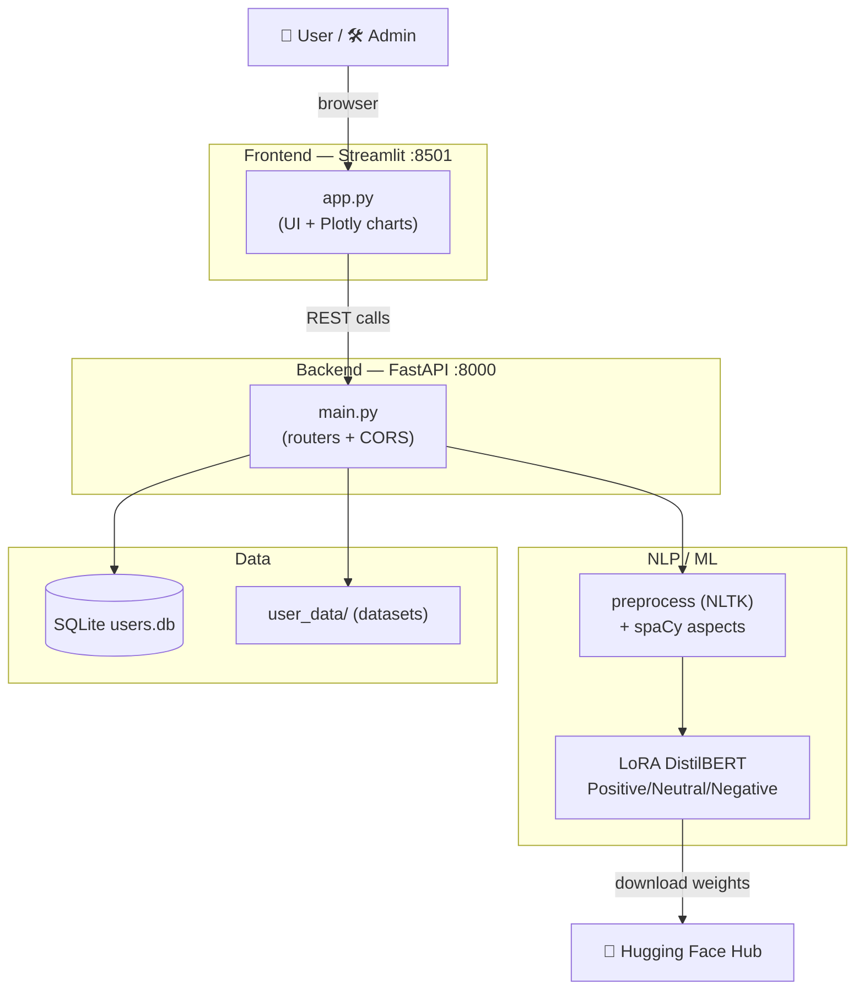
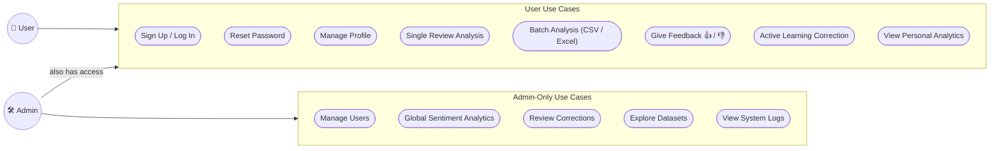

# 💬 ReviewSense

**AI-Powered Review Analysis and Chat-based Feedback Management System**

---

## 📘 About the Project

**ReviewSense** is an AI-driven feedback analysis platform built using **Streamlit** and **FastAPI**, designed to extract meaningful insights from customer reviews.
It combines **secure user authentication**, **profile management**, **aspect-based sentiment analysis**, **active learning**, and an **admin control panel** through an intuitive and interactive interface.

### 👤 Users can:
- 🔐 Sign up, log in, and manage their profiles securely (Argon2 password hashing)
- 📝 Analyze a single review for **overall** and **aspect-level** sentiment
- 📂 Upload CSV/Excel files for **batch** sentiment prediction
- 🧠 Analyze feedback using a fine-tuned **LoRA DistilBERT** model trained for 3 sentiment labels:
  - `Positive`, `Neutral`, and `Negative`
- 🎯 Correct wrong predictions through **Active Learning** to improve the model over time
- 👍 👎 Give thumbs up/down feedback on predictions
- 🛠 Admins get a dedicated dashboard for users, global analytics, corrections, datasets, and logs

All user and prediction data are stored securely in a **SQLite database**, ensuring persistence and integrity.

---

## ⚙️ Tech Stack

| Layer | Technology |
|-------|-------------|
| Frontend | Streamlit (Python), Plotly |
| Backend | FastAPI (Uvicorn) |
| Database | SQLite (`users.db`) |
| Model | LoRA fine-tuned DistilBERT (`Shiva-k22/sentiment-lora-distilbert`) |
| Aspect Extraction | spaCy (`en_core_web_sm`) — noun chunks + named entities |
| Preprocessing | NLTK (stopwords, lemmatization) |
| Authentication | Argon2 Password Hashing (`passlib`) |
| Deployment | Local / Docker-ready setup |

---

## 🏗️ Architecture Diagram



**Flow summary**
1. The **Streamlit** frontend renders the UI and sends REST calls to the **FastAPI** backend at `http://127.0.0.1:8000`.
2. Sentiment requests are preprocessed (NLTK) and run through **spaCy** for aspect extraction + the **LoRA DistilBERT** model for classification.
3. All users, predictions, corrections, feedback, and logs are persisted in **SQLite**; uploaded datasets land in `user_data/`.

---

## 🎯 Use Case Diagram



**Actors**
- **User** — authenticates, analyzes reviews (single/batch), gives feedback, applies corrections, views own analytics.
- **Admin** — every User use case, plus the Admin-only use cases (visible only to `admin@springboard.com`).

---

## 🚀 Setup Instructions

### Prerequisites
- **Python 3.9+** (3.10 or 3.11 recommended)
- `pip` and `venv`
- ~2 GB free disk space (PyTorch + transformer model weights)
- Internet access on first run (downloads the Hugging Face model + NLTK/spaCy data)

### 1️⃣ Clone the Repository
```bash
git clone https://github.com/ShivaKumarKaranam2/Review-sense-extract-insights-from-customer-feedback.git
cd Review-sense-extract-insights-from-customer-feedback
```

### 2️⃣ Create and Activate a Virtual Environment
```bash
python -m venv venv

# macOS / Linux
source venv/bin/activate

# Windows
venv\Scripts\activate
```

### 3️⃣ Install Dependencies
```bash
pip install -r requirements.txt
```

### 4️⃣ Download the spaCy Language Model
The backend uses `en_core_web_sm` for aspect extraction:
```bash
python -m spacy download en_core_web_sm
```

### 5️⃣ Run the Backend (FastAPI)
Run from the **project root** so the `backend.*` imports resolve:
```bash
uvicorn backend.main:app --reload
```
- Backend: **http://127.0.0.1:8000**
- Interactive API docs: **http://127.0.0.1:8000/docs**

> On the first prediction the model `Shiva-k22/sentiment-lora-distilbert` is downloaded from Hugging Face — this can take a minute.

### 6️⃣ Run the Frontend (Streamlit)
Open a **second terminal**, activate the same virtual environment, then run from the project root:
```bash
streamlit run frontend/app.py
```
- Frontend: **http://localhost:8501**

### 7️⃣ Log In
- Create an account via **Sign Up**, or
- Log in as admin with **`admin@springboard.com`** to unlock the Admin Dashboard.

---

## 🧩 Project Structure

```
Review-sense-extract-insights-from-customer-feedback/
│
├── backend/
│   ├── main.py                 # FastAPI main entry (routers + CORS)
│   ├── models.py               # Pydantic request/response models
│   ├── database.py             # SQLite connection, schema init & CRUD
│   ├── utils.py                # Argon2 hashing, tokens, text cleaning
│   ├── sentiment.py            # Model loading, aspect + sentiment inference
│   └── routes/
│       ├── auth.py             # Signup, login, password reset
│       ├── profile.py          # Profile fetch/update, user stats
│       ├── upload.py           # Dataset upload
│       ├── active_learning.py  # Save/fetch human corrections
│       ├── feedback.py         # 👍/👎 prediction feedback
│       ├── admin.py            # Admin users/stats/datasets/logs
│       └── logs.py             # System log endpoints
│
├── frontend/
│   └── app.py                  # Streamlit frontend (single entry point)
│
├── user_data/                  # Uploaded datasets (per-user folders)
├── users.db                    # SQLite database (created on first run)
├── requirements.txt
└── README.md
```

---

## 🧠 Model Information

The project uses the fine-tuned model:
👉 **Shiva-k22/sentiment-lora-distilbert**

Trained to classify sentiments as:

| Label | Sentiment |
|-------|-----------|
| `LABEL_0` | Negative |
| `LABEL_1` | Neutral |
| `LABEL_2` | Positive |

---

## 🔌 Key API Endpoints

| Method | Endpoint | Description |
|--------|----------|-------------|
| POST | `/signup` | Register a new user |
| POST | `/login` | Authenticate a user |
| POST | `/forgot-password` | Generate a reset token |
| POST | `/reset-password` | Set a new password |
| GET | `/profile` · PUT `/update_profile` | Fetch / update profile |
| GET | `/user_stats` | Personal sentiment analytics |
| POST | `/sentiment/predict_single` | Analyze one review (overall + aspects) |
| POST | `/sentiment/predict_batch` | Analyze a CSV/Excel file |
| POST | `/active_learning/save` · GET `/active_learning/get` | Save / fetch corrections |
| POST | `/feedback/save` | Save 👍/👎 feedback |
| GET | `/logs/all` · `/logs/user` | System logs |
| GET | `/admin/users` · `/admin/global_stats` · `/admin/list_datasets` | Admin dashboards |

---

## 🏁 Conclusion

ReviewSense provides a secure and intelligent foundation for analyzing customer feedback with modern AI techniques.
It unifies authentication, aspect-based sentiment analysis, active learning, and admin analytics — paving the way for advanced feedback intelligence in future versions.

### 👨‍💻 Developed by

Shiva Kumar Karanam
